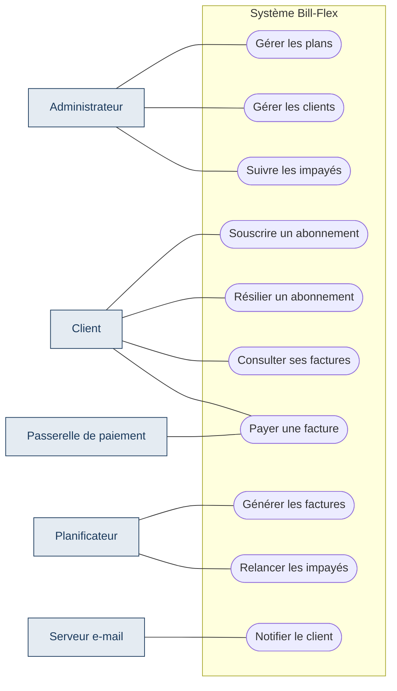
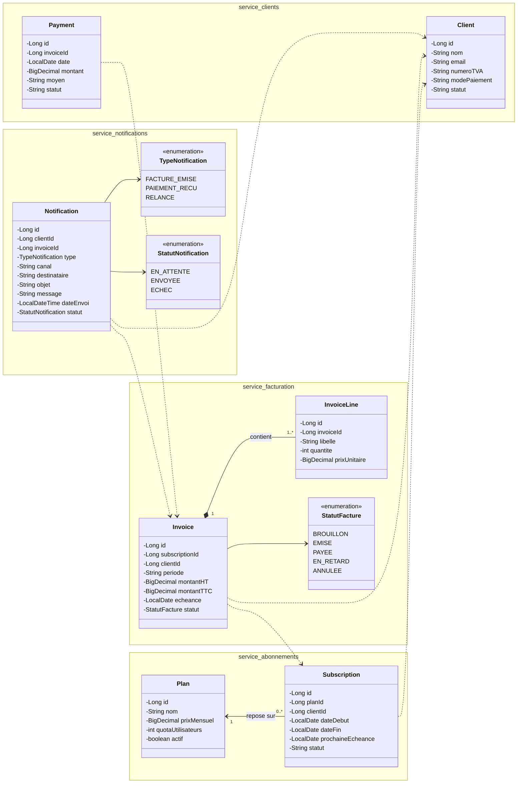
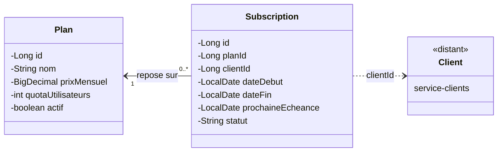
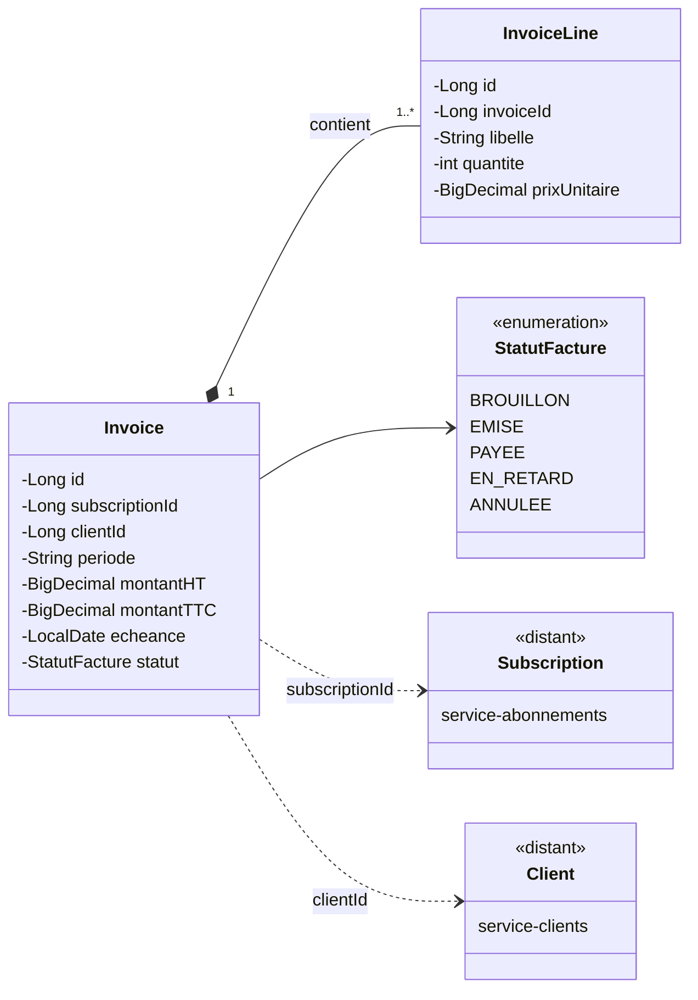
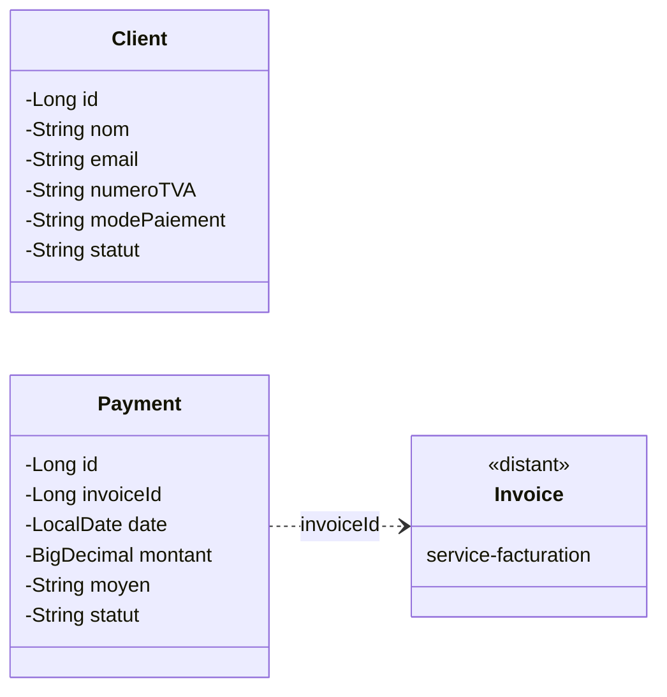
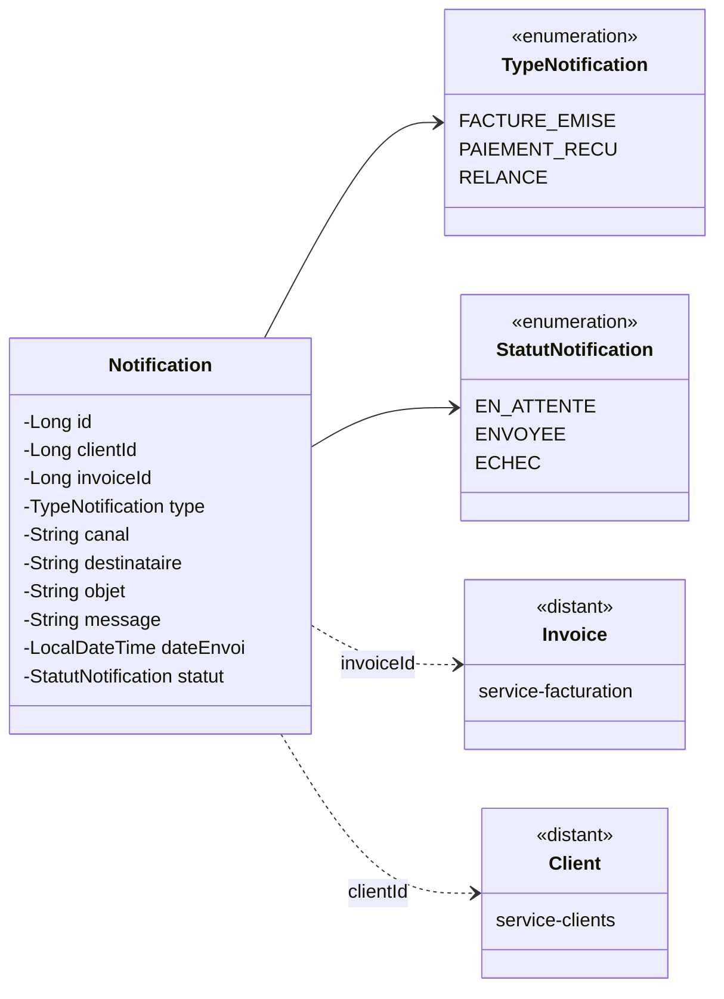

# Bill-Flex

## Description

**Bill-Flex** est une plateforme de facturation récurrente d'abonnements SaaS B2B, construite en architecture microservices.

Au renouvellement mensuel d'un abonnement, une facture est générée selon le plan souscrit, envoyée au client, encaissée, puis relancée automatiquement en cas d'impayé.

L'unité de traitement est la **Facture**, dont le cycle de vie est :

`BROUILLON` → `EMISE` → `PAYEE` / `EN_RETARD` → `ANNULEE`

Le projet comprend quatre services métier :

| Service | Responsabilité |
|---|---|
| `service-abonnements` | Catalogue de plans et abonnements clients |
| `service-facturation` | Factures et lignes de facturation (service principal) |
| `service-clients` | Comptes clients et paiements |
| `service-notifications` | Envoi et historique des notifications (facture émise, paiement reçu, relance) |

Ces services sont complétés par un serveur de découverte (Eureka), un serveur de configuration (Config Server) et une API Gateway.

---

## Diagramme de cas d'utilisation



| Acteur | Cas d'utilisation |
|---|---|
| Administrateur | Gérer les plans, gérer les clients, suivre les impayés |
| Client | Souscrire un abonnement, résilier un abonnement, consulter ses factures, payer une facture |
| Planificateur (système) | Générer les factures à l'échéance, relancer les impayés |
| Passerelle de paiement | Intervient dans « Payer une facture » |
| Serveur e-mail | Intervient dans « Notifier le client » (facture émise, paiement reçu, relance) |

---

## Diagramme de classes UML global

Les flèches en pointillés représentent les dépendances entre services (références par identifiant, sans préjuger du protocole de communication).



---

## Diagrammes de classes par microservice

Chaque service possède sa propre base de données : les références vers un autre service sont de simples identifiants (aucune clé étrangère, aucune relation JPA). L'existence de l'objet distant est vérifiée avant la création. Les classes marquées `<<distant>>` appartiennent à un autre service.

### service-abonnements



### service-facturation



### service-clients



### service-notifications



---

## Architecture

Le projet est composé de sept applications :

| Application | Rôle | Port |
|---|---|---|
| `api-gateway` | Point d'entrée unique, routage des requêtes | **8089** |
| `eureka-server` | Serveur de découverte de services | **8761** |
| `config-server` | Configuration externalisée des services | **8888** |
| `service-abonnements` | Plans et abonnements | **8081** |
| `service-facturation` | Factures et lignes de facturation | **8082** |
| `service-clients` | Clients et paiements | **8083** |
| `service-notifications` | Notifications (e-mails) | **8085** |


---

## Équipe

Brahim · Selma · Aymane · Hadil

---

## Message Broker (Kafka)

L'architecture utilise **Apache Kafka** comme bus d'événements asynchrone pour la communication inter-services.

### Topics publiés par `service-abonnements`

| Topic | Événement | Description |
|-------|-----------|-------------|
| `subscription-created` | `SUBSCRIPTION_CREATED` | Nouvel abonnement souscrit |
| `subscription-renewed` | `SUBSCRIPTION_RENEWED` | Abonnement renouvelé après expiration/résiliation |
| `subscription-expired` | `SUBSCRIPTION_EXPIRED` | Abonnement arrivé à expiration (cron journalier) |
| `subscription-cancelled` | `SUBSCRIPTION_CANCELLED` | Abonnement résilié manuellement |

### Topics consommés par `service-notifications`

| Topic | Source | Action |
|-------|--------|--------|
| `subscription-*` | `service-abonnements` | Envoi email (bienvenue, rappel, confirmation annulation) |
| `invoice-issued` | `service-facturation` | Notification facture émise |
| `payment-received` | `service-facturation` | Notification paiement reçu |

### Schéma d'événement (exemple)

```json
{
  "eventType": "SUBSCRIPTION_CREATED",
  "eventId": "uuid",
  "timestamp": "2026-11-22T10:00:00Z",
  "subscriptionId": 123,
  "clientId": 456,
  "planName": "Plan Pro",
  "dateDebut": "2026-11-22",
  "dateFin": "2027-11-22"
}
```

### Démarrage de l'infrastructure Kafka

```bash
docker compose up -d zookeeper kafka kafka-ui mailpit
```

- **Kafka UI** : http://localhost:8080 (visualisation topics, messages, consumer groups)
- **Mailpit UI** : http://localhost:8025 (capture emails SMTP sur port 1025)
- **Kafka Bootstrap** : `localhost:9092` (externe) / `kafka:29092` (interne Docker)

---

## Service de Notifications (`service-notifications`)

**Propriétaire** : Équipe dédiée (Selma)

Ce service consomme les événements Kafka et envoie les emails via Mailpit (dev) / SMTP (prod).

### Responsabilités
- Écoute les topics `subscription-*`, `invoice-issued`, `payment-received`
- Persiste l'historique des notifications en base (statut : EN_ATTENTE, ENVOYEE, ECHEC)
- Envoie les emails (templates HTML/text)
- Expose API REST pour consulter l'historique

### Configuration (config-repo/service-notifications.properties)
```properties
spring.kafka.bootstrap-servers=localhost:9092
spring.kafka.consumer.group-id=bill-flex-notifications
spring.mail.host=localhost
spring.mail.port=1025
notifications.mail.from=notifications@bill-flex.test
```

---

## Ordre de Démarrage (Run Order)

Lancer les services dans l'ordre suivant (chaque service attend que ses dépendances soient UP) :

```bash
# 1. Infrastructure
docker compose up -d zookeeper kafka kafka-ui mailpit

# 2. Plateforme (dans des terminaux séparés)
cd config-server     && ./mvnw spring-boot:run    # :8888
cd eureka-server     && ./mvnw spring-boot:run    # :8761
cd service-gateway   && ./mvnw spring-boot:run    # :8089

# 3. Services métier (ordre indifférent, mais clients en premier recommandé)
cd service-clients       && ./mvnw spring-boot:run  # :8083
cd service-facturation   && ./mvnw spring-boot:run  # :8082
cd service-abonnements   && ./mvnw spring-boot:run  # :8081
cd service-notifications && ./mvnw spring-boot:run  # :8085
```

### Vérifications rapides

| Service | Health Check | Interface |
|---------|--------------|-----------|
| Eureka | http://localhost:8761 | Dashboard instances UP |
| Config Server | http://localhost:8888/service-abonnements/default | Props servies |
| Gateway | http://localhost:8089/actuator/health | Routes découvertes |
| Kafka UI | http://localhost:8080 | Topics, messages |
| Mailpit | http://localhost:8025 | Emails capturés |

---

## Guide de Démo (Demo Steps)

### 1. Importer la collection Postman
- Fichier : `Bill-Flex-Service-Abonnements.postman_collection.json`
- Import : Postman → File → Import → sélectionner le fichier
- Variables d'environnement : `baseUrl` (8081), `gatewayUrl` (8089), `clientId`, `planId`

### 2. Créer un plan + client (prérequis)
```
POST {{baseUrl}}/api/plans          → crée un plan, note {{planId}}
POST {{gatewayUrl}}/api/clients     → crée un client, note {{clientId}}
```

### 3. Créer un abonnement (déclenche event Kafka + email)
```
POST {{baseUrl}}/api/abonnements
Header: Idempotency-Key: <auto-généré>
Body: { "planId": {{planId}}, "clientId": {{clientId}}, "dateDebut": "2026-11-22", "dateFin": "2027-11-22" }
```
→ **Observe** :
- Kafka UI → topic `subscription-created` → message JSON
- Mailpit UI → email de bienvenue au client

### 4. Tester l'agrégation V4 (2 appels Feign)
```
GET {{baseUrl}}/api/abonnements/{{subscriptionId}}/details      # 1 Feign (client)
GET {{baseUrl}}/api/abonnements/{{subscriptionId}}/full-details # 2 Feign (client + facturation)
```

### 5. Tester la résilience V6 (Circuit Breaker, Retry, Timeout)
```
GET {{baseUrl}}/api/abonnements/clients
Header: Chaos-Mode: fail      → 503 fallback (CB ouvert)

GET {{baseUrl}}/api/abonnements/{{subscriptionId}}/details
Header: Chaos-Mode: delay     → Retry x3 puis fallback

GET {{baseUrl}}/api/abonnements/{{subscriptionId}}/full-details
Header: Chaos-Mode: timeout   → Timeout 3s → fallback
```

### 6. Tester l'idempotence
```
POST {{baseUrl}}/api/abonnements (Idempotency-Key: fixed-key-123) → 201 Created
POST {{baseUrl}}/api/abonnements (Idempotency-Key: fixed-key-123) → 200 OK, même ID
```

### 7. Cycle de vie complet (events Kafka)
```
POST .../renew          → topic subscription-renewed
PATCH .../cancel        → topic subscription-cancelled
Cron expireSubscriptions → topic subscription-expired
```
Chaque étape visible dans **Kafka UI** et email dans **Mailpit**.

---

## Collection Postman

Fichier : `Bill-Flex-Service-Abonnements.postman_collection.json`

### Structure
```
Bill-Flex Service Abonnements
├── Local Direct (port 8081)
│   ├── Plans (CRUD)
│   ├── Abonnements (CRUD + cycle de vie)
│   ├── Aggregation (details / full-details)
│   ├── Resilience (CB, Retry, Timeout via Chaos-Mode)
│   └── Idempotency (duplicate create test)
└── Via Gateway (port 8089)
    ├── Plans (CRUD via gateway)
    └── Abonnements (CRUD + aggregation via gateway)
```

### Variables
| Variable | Description | Exemple |
|----------|-------------|---------|
| `baseUrl` | URL directe service-abonnements | `http://localhost:8081` |
| `gatewayUrl` | URL via API Gateway | `http://localhost:8089` |
| `clientId` | ID client existant | `1` |
| `planId` | ID plan existant | `1` |
| `subscriptionId` | Auto-rempli après create | `42` |
| `idempotencyKey` | Auto-généré par pre-request script | `idem-123456789-abc` |

### Tests automatiques
Chaque requête inclut des `pm.test()` :
- Code de statut attendu
- Structure JSON (schéma)
- Idempotence (même ID sur duplicate)
- Fallback résilience (503 avec message)

---

## Résilience (V6) — Détails Techniques

### Circuit Breaker + Retry + Timeout sur 2 appels Feign
- `ClientServiceGateway.getClientById()` → `@CircuitBreaker` + `@Retry` + `@TimeLimiter`
- `ClientServiceGateway.getAllClients()` → `@CircuitBreaker` + `@Retry` + `@TimeLimiter`

### Configuration (config-repo/service-abonnements.properties)
```properties
# Circuit Breaker
resilience4j.circuitbreaker.instances.clientById.failureRateThreshold=50
resilience4j.circuitbreaker.instances.clientById.waitDurationInOpenState=10s

# Retry
resilience4j.retry.instances.clientById.maxAttempts=3
resilience4j.retry.instances.clientById.waitDuration=500ms

# Timeout (TimeLimiter)
resilience4j.timelimiter.instances.clientById.timeoutDuration=3s
resilience4j.timelimiter.instances.clientById.cancelRunningFuture=true
```

### Démonstration via Postman
Utiliser le header `Chaos-Mode` sur les endpoints de test :
- `fail` : force une exception → CB s'ouvre après 3 échecs → fallback 503
- `delay` : simule latence → Retry x3 (500ms intervalle) → puis fallback
- `timeout` : simule attente >3s → TimeLimiter annule → fallback 503

---

## Idempotence (V6)

### Implémentation
- Header requis : `Idempotency-Key` (max 100 caractères)
- Stockage : colonne `idempotency_key` (UNIQUE) dans table `abonnements`
- Logique : `create()` vérifie existence → si trouvée, retourne l'existant (200) au lieu de créer (201)

### Test Postman
Dossier "Idempotency Demo" :
1. `Create Subscription (Idempotency-Key: fixed-key-123)` → 201
2. `Duplicate Create with Same Idempotency-Key` → 200, même `id`