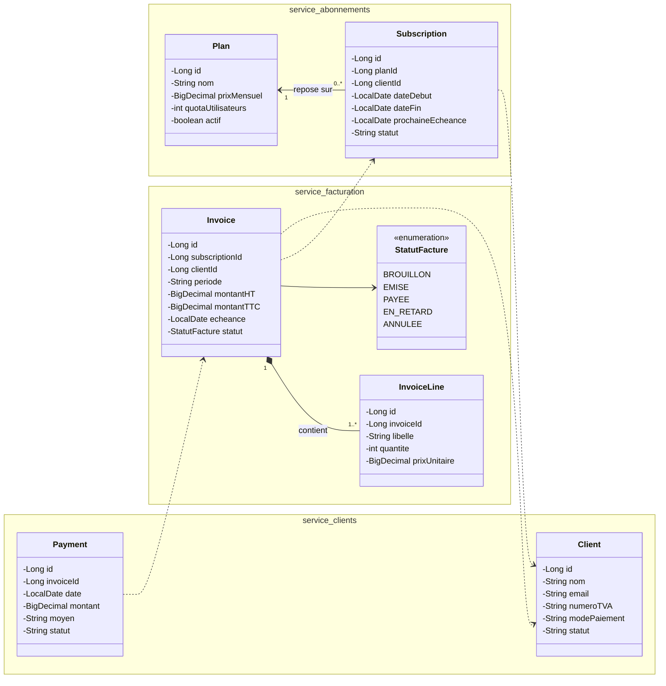
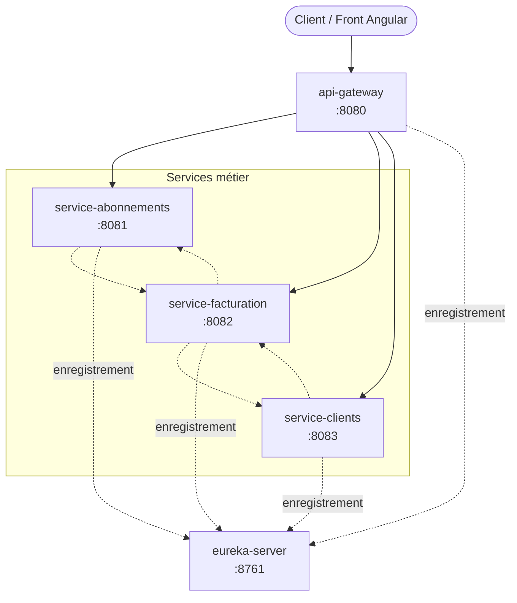

# Bill-Flex

## Description

**Bill-Flex** est une plateforme de facturation récurrente d'abonnements SaaS B2B, construite en architecture microservices.

Au renouvellement mensuel d'un abonnement, une facture est générée selon le plan souscrit, envoyée au client, encaissée, puis relancée automatiquement en cas d'impayé.

L'unité de traitement est la **Facture**, dont le cycle de vie est :

`BROUILLON` → `EMISE` → `PAYEE` / `EN_RETARD` → `ANNULEE`

Le projet comprend trois services métier :

| Service | Responsabilité |
|---|---|
| `service-abonnements` | Catalogue de plans et abonnements clients |
| `service-facturation` | Factures et lignes de facturation (service principal) |
| `service-clients` | Comptes clients et paiements |

Ces services sont complétés par un serveur de découverte (Eureka) et une API Gateway.

---

## Diagramme de classes UML global

Les flèches en pointillés représentent les dépendances entre services (références par identifiant, sans préjuger du protocole de communication).

---

## Architecture

Le projet est composé de cinq applications :

| Application | Rôle | Port |
|---|---|---|
| `api-gateway` | Point d'entrée unique, routage des requêtes | **8080** |
| `eureka-server` | Serveur de découverte de services | **8761** |
| `service-abonnements` | Plans et abonnements | **8081** |
| `service-facturation` | Factures et lignes de facturation | **8082** |
| `service-clients` | Clients et paiements | **8083** |

---

## Équipe

Brahim · Selma · Aymane · Hadil
