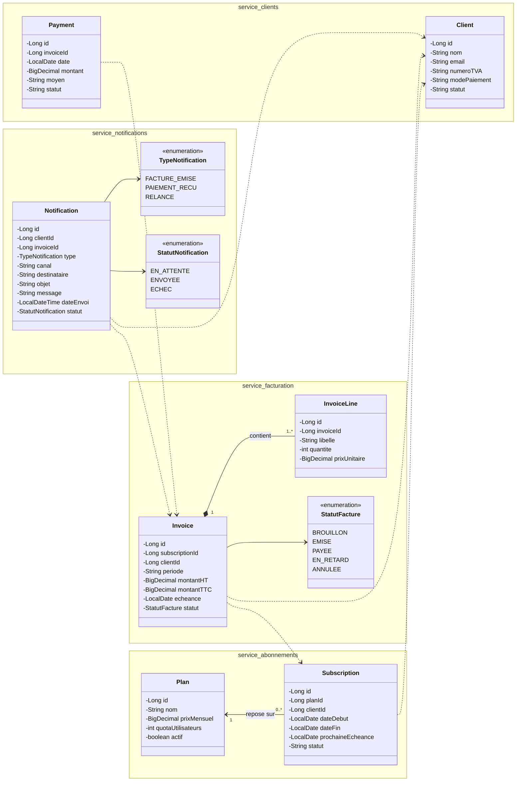
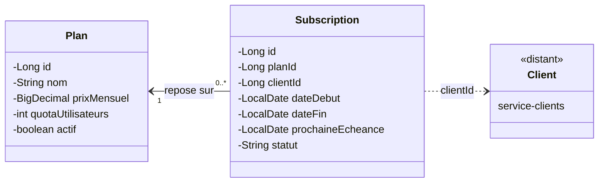
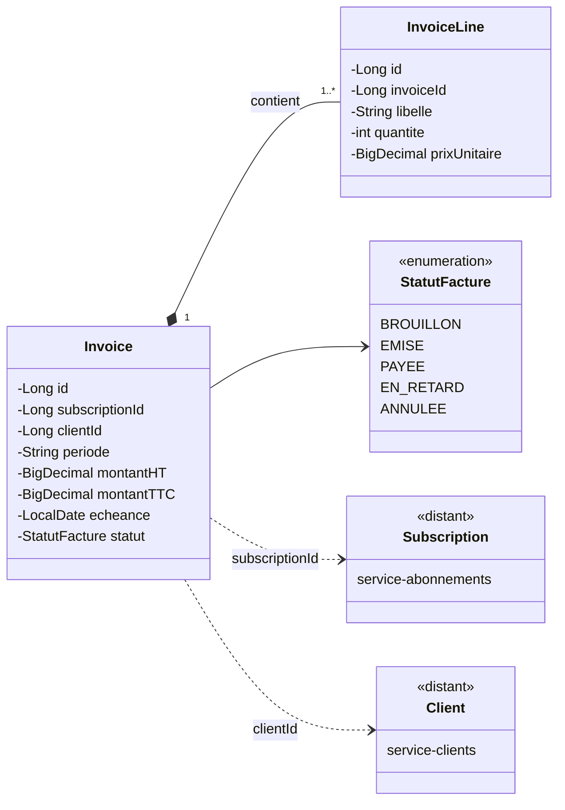
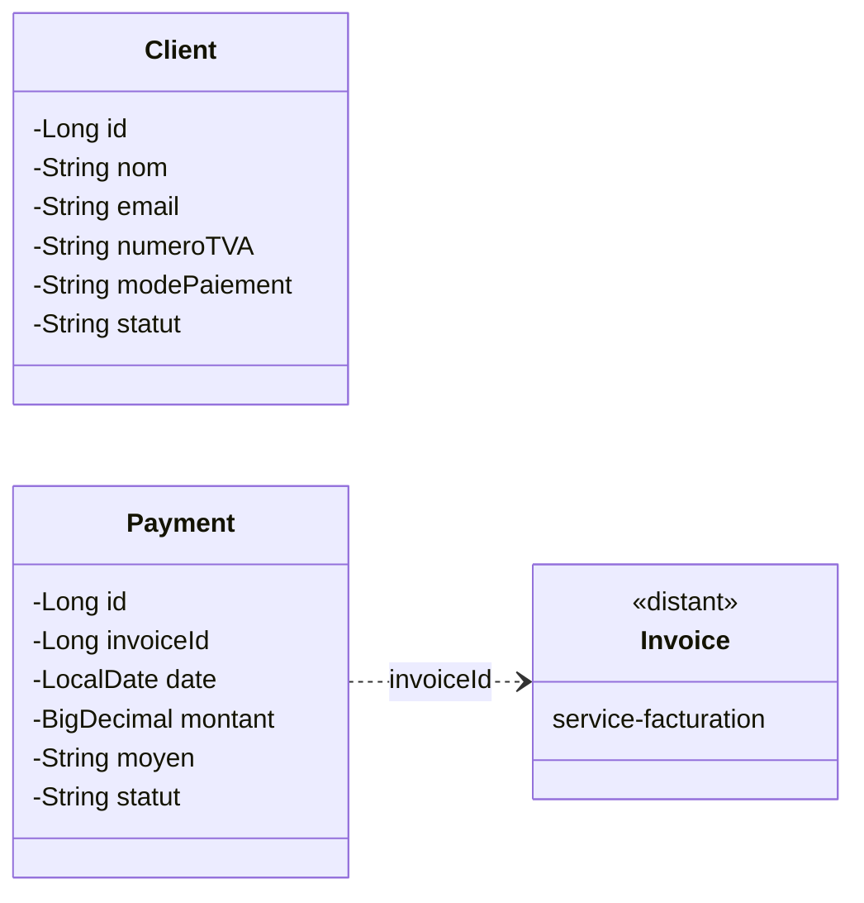
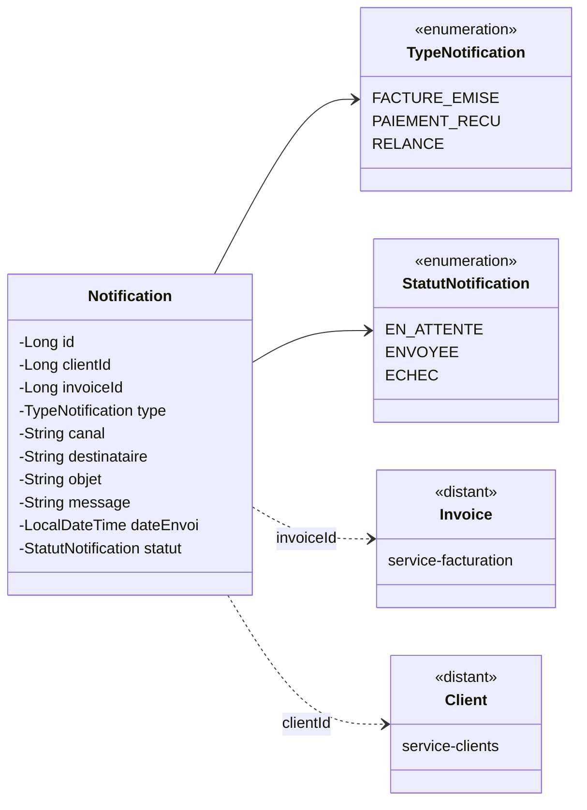
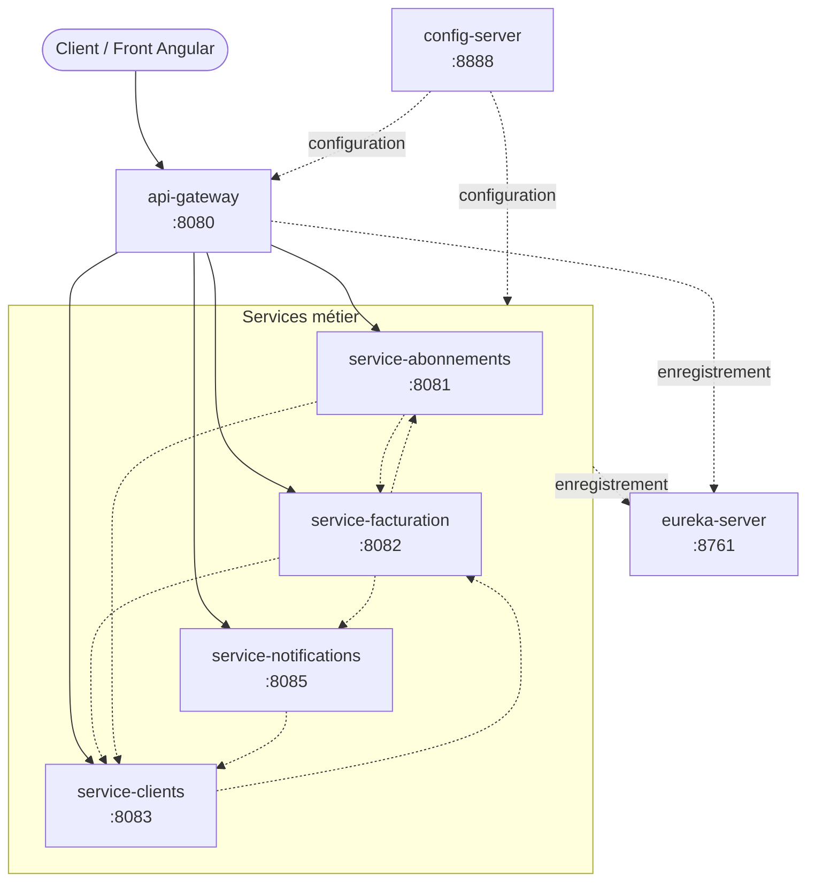

# Bill-Flex

## Description

**Bill-Flex** est une plateforme de facturation récurrente d'abonnements SaaS B2B, construite en architecture microservices.

Au renouvellement mensuel d'un abonnement, une facture est générée selon le plan souscrit, envoyée au client, encaissée, puis relancée automatiquement en cas d'impayé.

L'unité de traitement est la **Facture**, dont le cycle de vie est :

`BROUILLON` → `EMISE` → `PAYEE` / `EN_RETARD` → `ANNULEE`

Le projet comprend quatre services métier :

| Service | Responsabilité |
|---|---|
| `service-abonnements` | Catalogue de plans et abonnements clients |
| `service-facturation` | Factures et lignes de facturation (service principal) |
| `service-clients` | Comptes clients et paiements |
| `service-notifications` | Envoi et historique des notifications (facture émise, paiement reçu, relance) |

Ces services sont complétés par un serveur de découverte (Eureka), un serveur de configuration (Config Server) et une API Gateway.

---

## Diagramme de cas d'utilisation

| Acteur | Cas d'utilisation |
|---|---|
| Administrateur | Gérer les plans, gérer les clients, suivre les impayés |
| Client | Souscrire un abonnement, résilier un abonnement, consulter ses factures, payer une facture |
| Planificateur (système) | Générer les factures à l'échéance, relancer les impayés |
| Passerelle de paiement | Intervient dans « Payer une facture » |
| Serveur e-mail | Intervient dans « Notifier le client » (facture émise, paiement reçu, relance) |

---

## Diagramme de classes UML global

Les flèches en pointillés représentent les dépendances entre services (références par identifiant, sans préjuger du protocole de communication).

---

## Diagrammes de classes par microservice

Chaque service possède sa propre base de données : les références vers un autre service sont de simples identifiants (aucune clé étrangère, aucune relation JPA). L'existence de l'objet distant est vérifiée avant la création. Les classes marquées `<<distant>>` appartiennent à un autre service.

### service-abonnements

### service-facturation

### service-clients

### service-notifications

---

## Architecture

Le projet est composé de sept applications :

| Application | Rôle | Port |
|---|---|---|
| `api-gateway` | Point d'entrée unique, routage des requêtes | **8080** |
| `eureka-server` | Serveur de découverte de services | **8761** |
| `config-server` | Configuration externalisée des services | **8888** |
| `service-abonnements` | Plans et abonnements | **8081** |
| `service-facturation` | Factures et lignes de facturation | **8082** |
| `service-clients` | Clients et paiements | **8083** |
| `service-notifications` | Notifications (e-mails) | **8085** |

---

## Équipe

Brahim · Selma · Aymane · Hadil