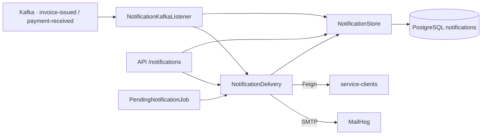
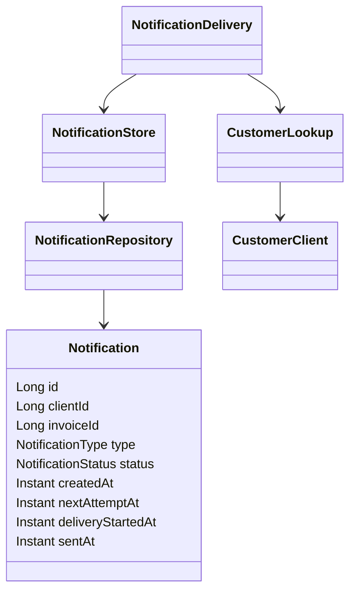

# Notifications et environnement de démonstration Bill-Flex

Cette contribution couvre le service de notifications et l’infrastructure locale. Les événements publiés manuellement et le simulateur HTTP permettent de vérifier la livraison indépendamment des services de l’équipe.

## Démarrage local sous Windows

Utiliser un JDK 17 ou supérieur, Maven 3.9.x ou le wrapper du dépôt, Docker Engine avec Docker Compose v2 ou supérieur, et Python 3 pour le simulateur. Les commandes partent de la racine du dépôt.

```powershell
Copy-Item .env.example .env
```

Remplir les quatre valeurs de `.env` avec des mots de passe locaux distincts. La commande `[guid]::NewGuid().ToString('N')` génère une valeur hexadécimale. Git ignore le fichier `.env`.

```powershell
docker compose config --quiet
docker compose up -d --wait postgres-abonnements postgres-facturation postgres-clients postgres-notifications kafka mailhog
docker compose run --rm --no-deps kafka-init
docker compose ps
```

| Ressource | Depuis Windows | Depuis le réseau Compose |
|---|---|---|
| PostgreSQL abonnements | `jdbc:postgresql://localhost:55431/abonnements` | `postgres-abonnements:5432/abonnements` |
| PostgreSQL facturation | `jdbc:postgresql://localhost:55432/facturation` | `postgres-facturation:5432/facturation` |
| PostgreSQL clients | `jdbc:postgresql://localhost:55433/clients` | `postgres-clients:5432/clients` |
| PostgreSQL notifications | `jdbc:postgresql://localhost:55434/notifications` | `postgres-notifications:5432/notifications` |
| Kafka en mode KRaft | `localhost:9092` | `kafka:29092` |
| MailHog SMTP et Web | `localhost:1025` et [boîte MailHog](http://localhost:8025) | `mailhog:1025` et `mailhog:8025` |

Chaque base a son propre volume, utilisateur et mot de passe. Le broker a aussi un volume. MailHog garde les messages en mémoire pendant son exécution. Les ports Compose sont publiés sur la boucle locale. `docker compose stop` conserve les volumes. `kafka-init` peut être relancé pour vérifier ou créer les topics.

Dans un deuxième terminal, démarrer le simulateur client.

```powershell
python -B docs/notifications/demo_client.py
```

Dans un troisième terminal, démarrer le service de notifications. Le mode par défaut utilise la configuration locale du module et écoute sur `127.0.0.1:8084`.

```powershell
$line = Get-Content .env | Where-Object { $_ -like 'NOTIFICATIONS_DB_PASSWORD=*' } | Select-Object -First 1
$env:NOTIFICATIONS_DB_PASSWORD = $line.Split('=', 2)[1]
$env:NOTIFICATIONS_CUSTOMER_URL = 'http://localhost:18083'
mvn -pl service-notifications spring-boot:run
```

L’URL PostgreSQL, l’utilisateur, le bootstrap Kafka et le SMTP ont les valeurs locales du tableau par défaut. On peut les surcharger avec `NOTIFICATIONS_DB_URL`, `NOTIFICATIONS_DB_USER`, `KAFKA_BOOTSTRAP_SERVERS`, `NOTIFICATIONS_SMTP_HOST` et `NOTIFICATIONS_SMTP_PORT`. La base dédiée doit être vierge ou initialisée avec le schéma du module.

Pour l’intégration d’équipe, activer le profil `cloud` avec `$env:SPRING_PROFILES_ACTIVE = 'cloud'`. Le Config Server doit servir `service-notifications.properties` depuis sa source. Démarrer Config Server et Eureka avant les applications clientes, puis clients avant le test de livraison. Laisser `NOTIFICATIONS_CUSTOMER_URL` vide pour la découverte Eureka par le nom `service-clients`, ou définir l’URL directe. Brahim doit réserver le port 8081 à abonnements et le port 8084 à notifications.

## Contrats d’intégration à confirmer avec l’équipe

| Fournisseur | Contrat attendu par notifications |
|---|---|
| Selma · clients | `GET /api/clients/{id}` renvoie `200` et un corps JSON `{"id":42,"email":"client.demo@bill-flex.test"}`. L’identifiant doit être celui demandé. Un client inexistant renvoie `404`. Les erreurs réseau, `429` et `5xx` déclenchent une reprise. |
| Aymane · facturation | Publier `invoice-issued` après validation de l’émission. Le JSON contient `eventId` (chaîne non vide, 128 caractères maximum), `invoiceId` et `clientId` (entiers positifs). Utiliser `invoiceId` comme clé Kafka. |
| Selma · paiements | `payment-received` fournit les mêmes trois champs pour la confirmation de paiement. Les champs JSON supplémentaires sont acceptés. |
| Brahim · abonnements | `subscription-renewed` est destiné à facturation. Le cycle complet dépend de sa publication lors du renouvellement et du traitement par Aymane. |

Les messages utilisent du JSON UTF-8 sans en-têtes de type Java. Notifications déduplique par `(invoiceId, type)`. Un événement rejeté va vers `invoice-issued.DLT` ou `payment-received.DLT`. Les erreurs de traitement transitoires côté listener ont deux nouvelles tentatives avant la DLT. Le rejeu d’un message corrigé doit conserver l’identifiant de facture original.

## Démonstration isolée jusqu’à MailHog

Le simulateur répond pour le client `42` uniquement. Dans un terminal supplémentaire, publier un événement de test et consulter la facture après traitement.

```powershell
$invoiceId = [DateTimeOffset]::UtcNow.ToUnixTimeMilliseconds()
$event = @{ eventId = [guid]::NewGuid().ToString(); invoiceId = $invoiceId; clientId = 42 } |
  ConvertTo-Json -Compress
"$invoiceId|$event" | docker compose exec -T kafka /opt/kafka/bin/kafka-console-producer.sh --bootstrap-server kafka:29092 --topic invoice-issued --property parse.key=true --property "key.separator=|"
Invoke-RestMethod "http://localhost:8084/notifications?invoiceId=$invoiceId"
```

Attendre le statut `ENVOYEE`, vérifier `sentAt`, puis retrouver le même numéro de facture dans MailHog. Republier la même ligne dans Kafka et vérifier qu’une seule notification et un seul e-mail d’émission existent pour la facture. Pour tester une panne clients, arrêter le simulateur, publier un nouvel identifiant de facture et vérifier `EN_ATTENTE` avec `CLIENT_INDISPONIBLE`. Relancer le simulateur et attendre la reprise automatique. Pour tester le paiement, publier le même JSON avec un nouvel `eventId` sur `payment-received` et vérifier la seconde notification `PAIEMENT_RECU`.

Ce scénario couvre Kafka → notifications → SMTP avec un événement injecté. Pour la démonstration d’équipe, remplacer l’injection par un renouvellement suivi de l’émission de la facture. Le paiement doit venir de clients et mettre ensuite la facture à `PAYEE` dans facturation.

## API et tests

Importer [la collection Postman Notifications](./Bill-Flex-notifications.postman_collection.json). La variable `baseUrl` vaut `http://localhost:8084` et `clientId` vaut `42` par défaut. Exécuter les requêtes de création avant les consultations et le rejeu manuel.

| Requête | Résultat attendu |
|---|---|
| `GET /notifications` | Liste des notifications. Les filtres `clientId` et `invoiceId` sont facultatifs et combinables. |
| `GET /notifications/{id}` | Notification, ou `404` avec le code `NOTIFICATION_INTROUVABLE`. |
| `POST /notifications` | Création manuelle avec `clientId`, `invoiceId`, et `type` parmi `FACTURE_EMISE`, `PAIEMENT_RECU`, `RELANCE`. Réponse `201` avec `Location`. |
| Requête invalide ou création répétée | `400 REQUETE_INVALIDE` ou `409 NOTIFICATION_EXISTANTE`. |

```powershell
mvn -pl service-notifications test
```

La suite utilise H2 en mode PostgreSQL, un broker Kafka embarqué, une réponse HTTP simulée pour clients et un récepteur SMTP de test. Elle vérifie persistance, unicité concurrente, API, Feign, reprise, rejeu Kafka, DLT et livraison via `JavaMailSender`. Le scénario Compose permet de vérifier PostgreSQL et MailHog eux-mêmes.

## État et reprise

L’enregistrement existe en `EN_ATTENTE` avant la recherche du client. Un Retry borné et un Circuit Breaker protègent cet appel. Le service reporte les enregistrements de 30 secondes par défaut, avec un balayage toutes les 5 secondes. Les erreurs client définitives et SMTP passent à `ECHEC`. Un envoi réussi passe à `ENVOYEE`.

Une seule instance peut réserver la tentative SMTP en enregistrant `deliveryStartedAt` avant l’appel. Si le processus s’arrête entre cette réservation et la sauvegarde du résultat, l’enregistrement reste `EN_ATTENTE` avec `deliveryStartedAt`. La livraison est alors incertaine. Pour éviter un double envoi, le traitement automatique laisse cet enregistrement à vérifier dans la boîte SMTP ou les traces de remise.




