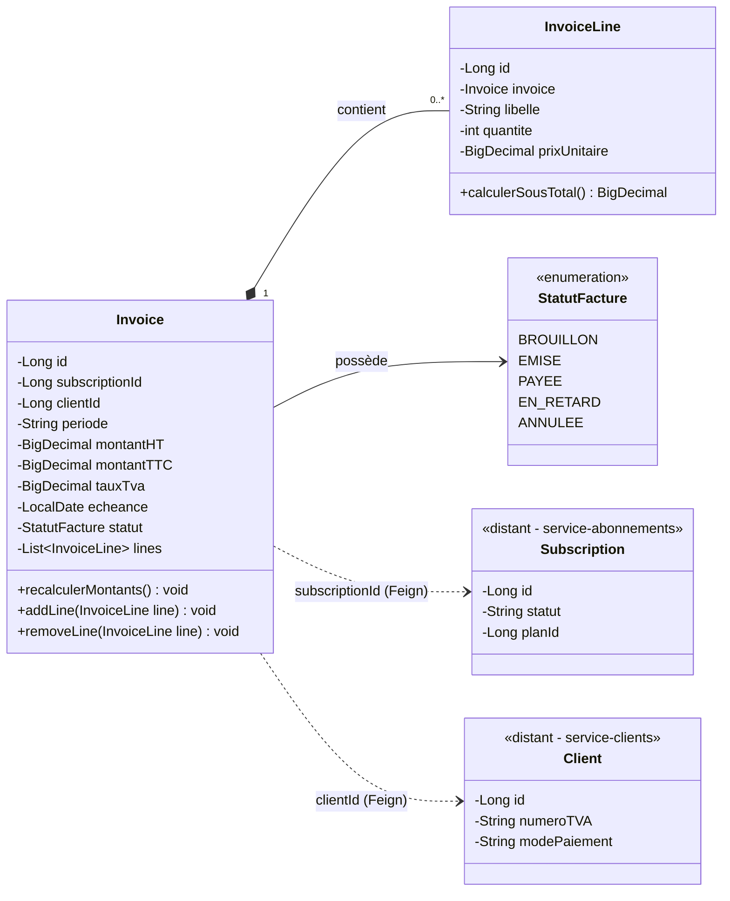
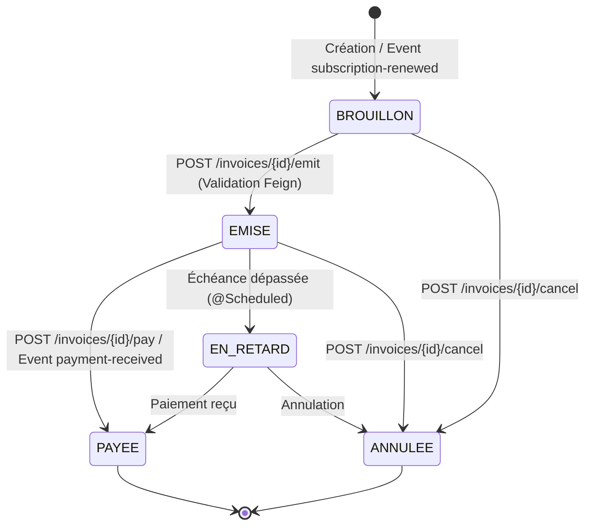

# Service Facturation (Bill-Flex) - Documentation Aymane

## 1. Présentation du service
Le **service-facturation** est le service principal du projet **Bill-Flex** (port **8082**). Il gère le cycle de vie des factures d'abonnements SaaS B2B, le calcul précis des montants (HT et TTC avec TVA), les lignes de facturation, les communications synchrones via OpenFeign, la publication et la consommation d'événements Kafka, ainsi que la résilience (Circuit Breaker, Retry, Idempotence).

---

## 2. Diagramme de classes UML (`service-facturation`)



---

## 3. Machine d'états des Factures



> **Règle de gestion (V1 / V6)** : Toute transition interdite (par exemple tenter d'émettre une facture déjà payée ou annuler une facture payée) renvoie immédiatement un statut HTTP **409 Conflict** via `IllegalStateTransitionException`.

---

## 4. Règles métier et Calculs

- **Montant HT** : somme des sous-totaux des lignes de facturation :
  $$\text{montantHT} = \sum (\text{quantite} \times \text{prixUnitaire})$$
- **Montant TTC** : calculé automatiquement avec le taux de TVA (20% par défaut) :
  $$\text{montantTTC} = \text{montantHT} \times \left(1 + \frac{\text{tauxTva}}{100}\right)$$

---

## 5. Communications et Intégration

### 5.1 Communication synchrone OpenFeign & Résilience (V4 & V6)
- **`service-abonnements`** :
  - Vérifie que l'abonnement associé existe et a le statut `ACTIF` / `ACTIVE` avant toute émission de facture.
  - Récupère les détails du plan pour le calcul initial et l'enrichissement.
- **`service-clients`** :
  - Vérifie la présence d'un `numeroTVA` valide et d'un `modePaiement` configuré avant le passage au statut `EMISE`.
- **Résilience (V6)** :
  - Protégé par **Resilience4j Circuit Breaker** et **Retry** (3 tentatives, validant l'exigence « au moins 2 appels »).
  - Méthodes de repli (*fallbacks*) propres en cas d'indisponibilité d'un service distant.

### 5.2 Endpoint enrichi (V4)
- **`GET /invoices/{id}/details`** :
  - Retourne un DTO composé complet (`InvoiceEnrichedResponse`) agrégeant :
    - La facture et ses lignes (`InvoiceResponse`)
    - Le client distant (`ClientDto`)
    - L'abonnement (`AbonnementDto`) et son plan (`PlanDto`)

### 5.3 Communication asynchrone Kafka (V5)
- **Publisher** :
  - Topic **`invoice-issued`** : publié lors de l'appel à `POST /invoices/{id}/emit`. Contient `invoiceId`, `subscriptionId`, `clientId`, `montantHT`, `montantTTC`, `echeance`, `periode`.
- **Consumers** :
  - Topic **`subscription-renewed`** : crée automatiquement la facture en statut `BROUILLON` pour la période avec la ligne de prestation issue du plan.
  - Topic **`payment-received`** : passe automatiquement la facture au statut `PAYEE`.

### 5.4 Idempotence (V6)
- Unicité stricte sur le couple **`(subscriptionId, periode)`** :
  - Contrainte unique en base de données (`uk_invoices_subscription_periode`).
  - Vérification applicative avant création : si un doublon d'événement Kafka est réémis, l'événement est ignoré sans altérer les données existantes.

### 5.5 Tâche planifiée des impayés (V6)
- **`InvoiceScheduler`** :
  - `@Scheduled(cron = "${invoices.scheduler.overdue.cron:0 0 1 * * *}")`
  - Recherche automatique de toutes les factures au statut `EMISE` dont l'échéance est antérieure à aujourd'hui et bascule automatique au statut `EN_RETARD`.
  - Endpoint manuel pour démonstration : `POST /invoices/check-overdue`.

---

## 6. Endpoints de l'API REST

| Méthode | URL | Description | Statut attendu |
|---|---|---|---|
| `POST` | `/invoices` | Créer une facture (`BROUILLON`) | 201 Created / 409 Conflict |
| `GET` | `/invoices` | Lister les factures (filtres: `clientId`, `subscriptionId`, `statut`) | 200 OK |
| `GET` | `/invoices/{id}` | Consulter une facture par ID | 200 OK / 404 Not Found |
| `GET` | `/invoices/{id}/details` | **Consultation enrichie** (facture + lignes + client + abonnement + plan) | 200 OK / 404 Not Found |
| `PUT` | `/invoices/{id}` | Modifier une facture (si `BROUILLON`) | 200 OK / 409 Conflict |
| `DELETE`| `/invoices/{id}` | Supprimer une facture (si `BROUILLON`) | 204 No Content / 409 Conflict |
| `GET` | `/invoices/{id}/lines` | Obtenir les lignes de la facture | 200 OK |
| `POST` | `/invoices/{id}/lines` | Ajouter une ligne à une facture (`BROUILLON`) | 201 Created / 409 Conflict |
| `DELETE`| `/invoices/{id}/lines/{lineId}`| Supprimer une ligne d'une facture (`BROUILLON`) | 200 OK / 409 Conflict |
| `POST` | `/invoices/{id}/emit` | **Émettre la facture** (vérifs Feign + passage `EMISE` + publish Kafka) | 200 OK / 400 / 409 |
| `POST` | `/invoices/{id}/pay` | Payer la facture (passage `PAYEE`) | 200 OK / 409 Conflict |
| `POST` | `/invoices/{id}/cancel` | Annuler la facture (passage `ANNULEE`) | 200 OK / 409 Conflict |
| `POST` | `/invoices/check-overdue` | Déclencher manuellement le scheduler des factures échues | 200 OK |

---

## 7. Structure des dossiers du service

```
service-facturation/
├── pom.xml
├── postman/
│   └── Bill-Flex-Facturation.postman_collection.json
├── src/
│   ├── main/
│   │   ├── java/org/gmp/servicefacturation/
│   │   │   ├── client/       # Feign Clients, Fallbacks & Resilience4j
│   │   │   ├── config/       # Configuration Kafka & Beans
│   │   │   ├── controller/   # InvoiceController REST
│   │   │   ├── dto/          # DTOs requêtes, réponses & événements
│   │   │   ├── entity/       # Invoice, InvoiceLine, StatutFacture
│   │   │   ├── exception/    # GlobalExceptionHandler (400, 404, 409, 503)
│   │   │   ├── kafka/        # InvoiceEventPublisher & InvoiceEventConsumer
│   │   │   ├── mapper/       # InvoiceMapper
│   │   │   ├── repository/   # InvoiceRepository, InvoiceLineRepository
│   │   │   ├── scheduler/    # InvoiceScheduler (@Scheduled)
│   │   │   └── service/      # InvoiceService (logique métier & machine d'états)
│   │   └── resources/
│   │       └── application.properties
│   └── test/
│       └── java/org/gmp/servicefacturation/
│           ├── InvoiceServiceTest.java       # Tests unitaires & métier
│           ├── InvoiceControllerTest.java    # Tests MockMvc & validation
│           └── ServiceFacturationApplicationTests.java
```
